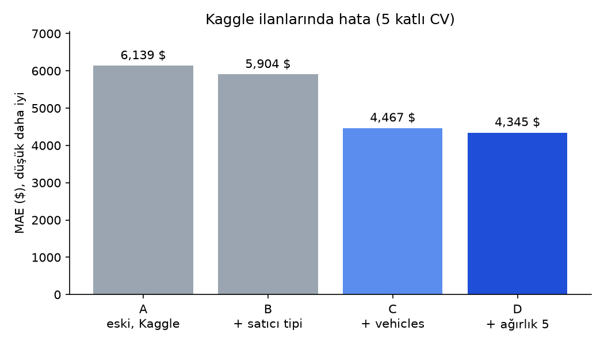
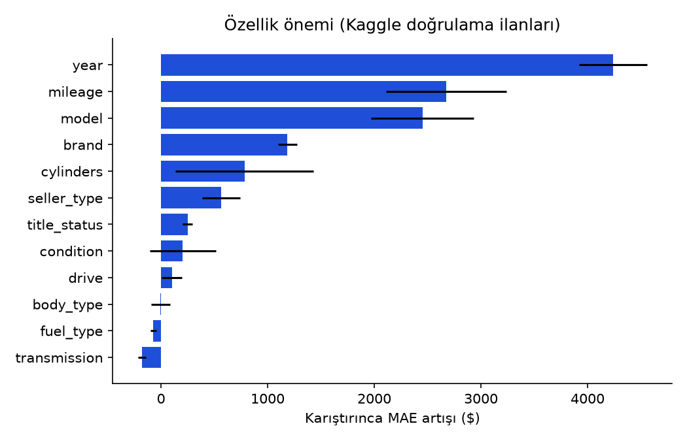

# İkinci El Araç Fiyat Tahmini

Bir aracın özelliklerinden ikinci el fiyatını **Türk lirası** olarak tahmin eden, baştan sona Python ile yazılmış bir web uygulaması. Python dersi dönem projesidir.

Model, Kaggle **Used Car Price Prediction Challenge** verisi ve aynı kaynaktan (Craigslist, ABD) toplanmış 295 bin ilanlık ek bir veri setiyle eğitildi. Dolar cinsinden tahmin eder. Servis katmanı bu tahmini TCMB'nin günlük kuru ve sahibinden.com fiyatlarından hesaplanan bir **Türkiye piyasa katsayısıyla** TL'ye çevirir.

| | |
|---|---|
| Eğitim verisi | 168.365 temiz ilan (652 Kaggle + 167.713 ek veri) |
| Model | HistGradientBoosting, monoton kısıtlı (km ↓, yıl ↑) |
| Doğruluk (5 katlı, Kaggle ilanlarında) | MAE **4.315 $** · R² **0,799** · tipik hata **%19,5** |
| Yalnız Kaggle verisiyle aynı ölçüm | MAE 6.139 $ · R² 0,485 · tipik hata %27,1 |
| Tahmin süresi | ~0,1 sn |
| Testler | 103 test, ruff temiz |

## Ekip

| Kişi | Sorumluluk |
|---|---|
| Demir Kaan Demir | Veri, veritabanı, model eğitimi, servis katmanı (backend) |
| Osman Mengi | Streamlit arayüzü (frontend) |

> **Arayüz notu:** fiyatı servis doğrudan TL olarak döndürür. Arayüz dolar/TL
> dönüşümünü hesaplamaz veya göstermez; yalnızca TL fiyatı, olası aralığı ve
> model başarı ölçülerini sunar (MAE/RMSE backend metrikleri USD cinsindendir).

## Teknolojiler

Python 3.12 · Streamlit · pandas · scikit-learn · SQLite · joblib · pytest · ruff · GitHub Actions

---

## Neler yaptık

### 1. Veri: tanıma, temizlik, birleştirme

**Kaynaklar**

| Dosya | İlan | Not |
|---|---|---|
| `train_data_v2.csv` (Kaggle) | 784 | Haziran 2026, 28 sütun, çok kirli |
| `vehicles.csv` (ek veri) | 295.451 | Eylül–kasım 2026, aynı sütunlar + gerçek satıcı tipi (galeri / sahibi) |

**Önemli temizlik kararları** (tamamı gerekçeleriyle [docs/DATA.md](docs/DATA.md) içinde)

- **Marka, model, yıl ilan başlığından çıkarılır.** Kaggle'daki ham marka/model/yıl sütunları %90 boş. "2021 Ford Bronco Sport" gibi başlıklar ayrıştırılır.
- **Marka eşleştirmesi tahmine dayanmaz.** Açık bir marka listesi ve yalnızca tam kelime eşleşen takma adlar kullanılır (`chevy` → Chevrolet, `vw` → Volkswagen). Chery, Chevrolet'e dönüşmez; "John Deere Mini excavator" Mini sayılmaz.
- **Model adları birleştirilir.** "Grand Cherokee", "Santa Fe", "Land Cruiser" tek parça okunur. "3 Series" / "3SERIES", "RAV 4" / "RAV4", "F-150" / "F150" aynı modeldir.
- **Mil → km** çevrilir. Kategoriler Türkçe etiketlere eşlenir (Benzin, Otomatik, Ağır hasarlı…).
- **Satıcı tipi** (Galeri / Bireysel): ek veride hazır gelir, Kaggle verisinde ilan metninden çıkarılır ("dealer", "finance", "stock #"…). Bu kural ek verinin gerçek etiketlerine göre %86 doğru.
- **`clean()` hiç satır silmez**, yalnızca türleri düzeltir. Satır silme yalnızca eğitim verisinde, `filter_train_rows()` içinde yapılır.

**Çöp temizliği**

| Kural | Kaggle | Ek veri |
|---|---|---|
| Tekrar eden ilan | 0 | 98.042 |
| Fiyat 1.000 $ altı (peşinat / "fiyat için arayın" ilanı) | 6 | 14.409 |
| Km yok, 600 bin km üstü veya bozuk sayaç | 13 | 7.620 |
| Araç olmayan ilan / reklam (marka bulunamadı) | 40 | 4.453 |
| 2.000 km altı ama 2024 öncesi araç (sahte km) | 10 | 2.029 |
| Diğer (yıl yok, 250 bin $ üstü, "Parça için" ruhsat) | 63 | 1.170 |
| İki sette birden geçen ilan (sızıntı önlemi) | – | 15 |
| **Kalan** | **652** | **167.713** |

### 2. Veritabanı (SQLite)

`python -m src.db.load_data` iki CSV'yi temizleyip `data/cars.db` dosyasına yazar. Tekrar çalıştırılabilir.

| Tablo | İçerik |
|---|---|
| `cars` | Temiz ilanlar: 12 özellik, fiyat (USD), kaynak (`kaggle` / `vehicles`) |
| `predictions` | Arayüzde yapılan her tahmin: girdiler (JSON), TL fiyat, model sürümü |
| `model_runs` | Her eğitimin parametreleri ve metrikleri; kullanılan model `is_active = 1` |

- Kullanıcıdan gelen her değer SQL'e `?` parametresiyle verilir (SQL enjeksiyonuna kapalı).
- Her fonksiyon kendi bağlantısını açıp kapatır; Streamlit'in çoklu thread yapısıyla uyumludur.
- Marka ve marka+model sorguları için indeks var. Arayüzün model listesinde yalnızca en az 20 ilanı olan modeller çıkar.

### 3. Model eğitimi

`python -m src.ml.train` (yaklaşık 1 dakika). Adım adım anlatım: [docs/MODEL.md](docs/MODEL.md), çıktılı notebook'lar: `notebooks/03_modelleme.ipynb`, `notebooks/04_buyuk_veri.ipynb`.

**Özellikler (12):** yıl, km, silindir · marka, model, yakıt, vites, durum, çekiş, kasa tipi, ruhsat durumu, satıcı tipi

**Nasıl eğitildi**

1. **Hazırlık modelin içinde** (`Pipeline`): boş sayılar medyanla, boş kategoriler "Bilinmiyor" ile doldurulur. Kategoriler sıra koduna çevrilir; 20'den az görülen değerler tek grupta toplanır. Eğitimde ve tahminde birebir aynı işlem yapılır.
2. **Fiyat log ölçeğinde öğrenilir.** Fiyatlar çok çarpık olduğu için model dolar farkı yerine yüzde farkını küçültür.
3. **Monoton kısıt:** km artınca fiyat düşer, yıl artınca artar. Az veride ağaçların zikzak çizmesini engeller.
4. **Kaggle ilanlarına 5 kat ağırlık:** asıl hedef yarışma verisi; model ona daha çok uysun.
5. **Ölçüm:** 5 katlı çapraz doğrulama, hep aynı 652 Kaggle ilanında. Sınanan ilan eğitimde hiç görülmez, ek veri yalnızca eğitime girer.
6. **Final:** tüm veriyle yeniden eğitilir; `models/model.joblib` ve `models/model_meta.json` kaydedilir, `model_runs` tablosuna satır yazılır.

**Deneyler** (aynı 652 Kaggle ilanında, 5 katlı)

| Deneme | MAE | R² | Tipik hata |
|---|---|---|---|
| Baseline: herkese medyan fiyat (eski 771 ilanlık filtreyle ölçüldü) | 10.084 $ | −0,12 | – |
| Yalnız Kaggle, ilk model | 6.139 $ | 0,485 | %27,1 |
| Yalnız Kaggle + satıcı tipi | 5.904 $ | 0,507 | %26,4 |
| Kaggle + ek veri | 4.467 $ | 0,762 | %19,2 |
| + Kaggle ilanlarına 5 kat ağırlık | 4.345 $ | 0,792 | %19,9 |
| **+ model adı birleştirme (seçilen)** | **4.315 $** | **0,799** | **%19,5** |



**Model neye bakıyor?** (permutation importance) Yıl → km → model → marka → silindir → satıcı tipi.



**İlginç bulgu:** Yalnız Kaggle verisinde 130 bin km civarında sert bir fiyat kırılması vardı: fiyat %33 düşüyordu. Büyük veriyle bu kırılma neredeyse kayboldu: düşüş %7'ye indi. Yani kırılma az verinin yarattığı bir yanılsamaydı. Sebebi büyük ihtimalle düşük km'li ilanların çoğunun galeriden gelmesi.

### 4. Türkiye uyarlaması

```
TL fiyat = USD tahmini × TCMB günlük kuru × piyasa katsayısı × km çarpanı × (ağır hasarlıysa 0,65)
```

- **Kur:** TCMB'nin `today.xml` dosyasından USD döviz satış kuru. Günde bir kez çekilir. İnternet yoksa yedek kur kullanılır ve 10 dakika sonra TCMB yeniden denenir.
- **Piyasa katsayısı:** sahibinden.com'dan toplanan 12 aracın ortalama fiyatıyla modelin aynı araçlar için tahmini karşılaştırılarak hesaplanır. Segment bazında: ekonomik 1,87 · SUV 2,35 · premium 3,29 · elektrik 1,87. Referansı olan modeller kendi katsayısını kullanır.
- **Km çarpanı:** km'nin etkisi aracın yaşından ayrılarak hesaplanır. Üst sınırı modelin kendi fiyat eğrisinden türetilir.
- **Km zarfı:** aynı aracın daha düşük km'li hali daha ucuz olamaz. Fiyat, 0'dan aracın km'sine kadar 1.000 km adımlı ızgaradaki en düşük değerdir. Km arttıkça TL fiyat **hiçbir noktada yükselmez** (testle garanti).
- **Ağır hasar:** "Ağır hasarlı" ve "Ağır hasarlı (onarılmış)" araçlar tam %35 daha ucuz. Model aracı "Temiz" diye fiyatlar, indirim sonra uygulanır.
- **Satıcı tipi seçilmezse** galeri ve bireysel tahminlerinin ortalaması alınır; referans fiyatlar da karışık piyasa ortalaması olarak hesaba katılır.
- **Olası aralık:** geçmiş hataların %80'inin düştüğü aralık; tahminin yaklaşık 0,63 ile 1,51 katı arası.

Katsayı eğitimden **sonra** uygulanır. Bu yüzden modelin doğruluğu gerçek ilanlarla ölçülmeye devam eder; katsayıyı değiştirmek yeniden eğitim gerektirmez. Ayrıntılar: [docs/MODEL.md](docs/MODEL.md) §7.

### 5. Servis katmanı

Arayüz veritabanına ya da model dosyasına doğrudan dokunmaz, yalnızca `from src.core.api import service` ile şu fonksiyonları çağırır ([docs/CONTRACT.md](docs/CONTRACT.md)):

| Fonksiyon | Döndürür |
|---|---|
| `get_options()` | Açılır listeler: marka, yakıt, vites, durum, çekiş, kasa, ruhsat, satıcı |
| `get_models_for_brand(brand)` | Seçilen markanın modelleri (en az 20 ilanı olanlar) |
| `get_ranges()` | Sayı kutularının sınırları (yıl, km, silindir) |
| `predict(car)` | TL fiyat, olası aralık, kullanılan kur, model sürümü |
| `save_prediction(car, pred)` / `get_history()` | Tahmin geçmişi |
| `get_model_info()` | Model adı, sürüm, eğitim tarihi, MAE, RMSE, R², ilan sayısı |

`USE_MOCK=1` ile aynı imzalara sahip sahte servis çalışır. Arayüz geliştirmek için veri ya da model gerekmez.

### 6. Mimari

```
data/raw/train_data_v2.csv ─┐
data/raw/vehicles.csv ──────┴─► src/db/load_data.py ──► data/cars.db (SQLite)
                                                             │      ▲ tahmin geçmişi,
                                                             ▼      │ model kayıtları
                                                   src/ml/train.py  │
                                                             │      │
                         models/model.joblib, model_meta.json,      │
                         localization.json (Türkiye katsayıları)    │
                                                             ▼      │
                         TCMB kuru ──► src/core/service.py ─────────┘
                                                   ▲
                                                   │ yalnızca servis fonksiyonları
                                         app.py (Streamlit arayüzü)
```

---

## Kurulum

```bash
git clone https://github.com/MikaelAkerfelt19/Ara-fiyat-tahmini.git
cd Ara-fiyat-tahmini
python -m venv .venv
# Windows:      .venv\Scripts\activate
# macOS/Linux:  source .venv/bin/activate
pip install -r requirements.txt
```

## Veriyi indirme

Veri setleri repoya konmaz. Herkes kendi bilgisayarına indirir.

1. Kaggle'da yarışma sayfasına gir, **Join Competition** ile katıl ve kuralları kabul et.
2. **Data** sekmesinden **Download All** ile zip'i indir. İçindekileri (`train_data_v2.csv`, `test_data_v2.csv`, `sample_submission.csv`) `data/raw/` klasörüne çıkar.
3. **İsteğe bağlı, önerilir:** ek veri setini `data/raw/vehicles.csv` olarak koy (yaklaşık 295 bin Craigslist ilanı, 1,1 GB). Dosya yoksa sistem yalnız Kaggle verisiyle çalışır, ama model belirgin biçimde daha az doğru olur (MAE 6.139 $ ve 4.315 $).

Kaggle'a tahmin göndermeyi düşünüyorsan yarışmanın **Rules** sekmesinden dış veri kuralını kontrol et. **Kaggle API anahtarını (`kaggle.json`) asla repoya ekleme.**

## Çalıştırma

```bash
python -m src.db.load_data      # data/cars.db oluşturur (~15 sn)
python -m src.ml.train          # model.joblib, model_meta.json, localization.json üretir (~1 dk)
streamlit run app.py            # arayüzü gerçek servisle açar
```

Model hazır değilken arayüz sahte servisle çalışır:

```bash
USE_MOCK=1 streamlit run app.py              # macOS/Linux
$env:USE_MOCK="1"; streamlit run app.py      # Windows PowerShell
```

## Testler

```bash
pytest
ruff check . && ruff format --check .
```

Testler `data/` veya `models/` klasörüne ihtiyaç duymaz ve internete çıkmaz; GitHub Actions her PR'da çalıştırır. Öne çıkan testler:

- marka ayrıştırma (Chery ≠ Chevrolet)
- `clean()` hiç satır silmiyor
- km artarken TL fiyat hiçbir km'de yükselmiyor
- ağır hasar indirimi tam %35
- TCMB'ye ulaşılamazsa yedek kur
- servis ile sahte servisin imzaları birebir aynı

## Sınırlamalar

- **Veri ABD'den.** Türkiye fiyatları 12 referans araçla ayarlanan bir katsayıya dayanır. Referans araçların çoğu %3'ten az sapar, en büyük sapmalar RAV4'te (+%28 / −%22) ve Corolla'da (+%16 / −%13). Sebep: Türkiye'de eski araçlar değerini ABD'ye göre daha iyi koruyor.
- **ABD verisinde olmayan markalar tahmin edilemez:** Renault, Peugeot, Togg gibi. Formda yalnızca verideki markalar çıkar.
- **Olası aralık geniş** (yaklaşık −%37 / +%51). İlan fiyatları gürültülü; bu dürüst bir belirsizlik göstergesidir.
- **Tarih farkı:** Kaggle verisi haziran 2026, ek veri eylül–kasım 2026; fiyat dağılımları biraz farklı.

## Proje belgeleri

| Belge | İçerik |
|---|---|
| [docs/DATA.md](docs/DATA.md) | Veri sözlüğü, temizlik kararları ve gerekçeleri, ek veri seti |
| [docs/MODEL.md](docs/MODEL.md) | Deney günlüğü, seçilen model, özellik önemi, Türkiye uyarlaması |
| [docs/CONTRACT.md](docs/CONTRACT.md) | Arayüz ile backend'in buluştuğu servis sözleşmesi |
| [docs/PLAN.md](docs/PLAN.md) | Genel plan, mimari, takvim, kilometre taşları |
| [docs/GOREVLER_BACKEND.md](docs/GOREVLER_BACKEND.md) | Veri, DB ve model görevleri |
| [docs/EGITIM_REHBERI.md](docs/EGITIM_REHBERI.md) | Sıfırdan model eğitimi, adım adım |
| [docs/ARAYUZ_KONSEPT.md](docs/ARAYUZ_KONSEPT.md) | Arayüz konsepti: ekran, davranışlar, görevler |
| [CONTRIBUTING.md](CONTRIBUTING.md) | Git akışı, commit ve PR kuralları |
| [AGENTS.md](AGENTS.md) | Kodlama ajanları için proje kuralları |

**Notebook'lar:**

| Notebook | İçerik |
|---|---|
| `notebooks/02_eda.ipynb` | Keşifsel analiz |
| `notebooks/03_modelleme.ipynb` | İlk model karşılaştırması: baseline, Ridge, RandomForest, HistGB |
| `notebooks/04_buyuk_veri.ipynb` | Ek veri, çöp temizliği, A/B/C/D karşılaştırması |

## Ekran görüntüsü

_(Arayüz tamamlanınca eklenecek: `docs/img/arayuz.png`)_
