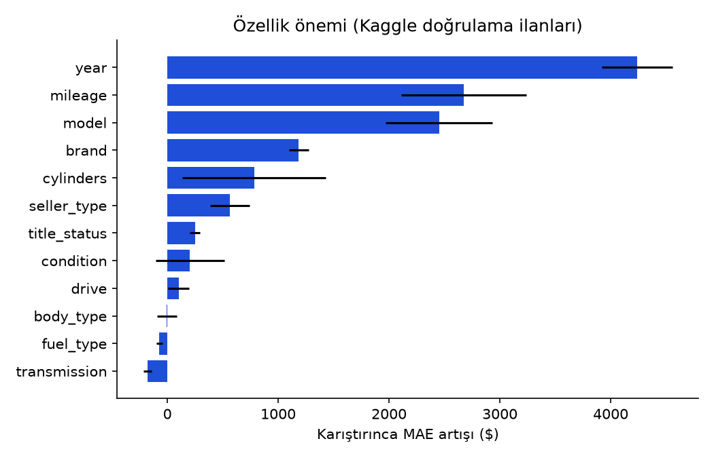

# Model Deney Günlüğü

> Sorumlu: Kaan · Durum: **Dolduruldu** (16 Kasım 2026)

## 1. Değerlendirme düzeni

- Doğrulama: `train.csv` verisinin %20'si ayrılır (`random_state=42`). Model bu kısmı eğitimde hiç görmez.
- Çapraz doğrulama: 5 katlı `KFold` (Adım 8'den itibaren)
- Ana metrik: **MAE** (ortalama mutlak hata, para birimi cinsinden; anlaması en kolay olan)
- Ek metrikler: RMSE, R²
- Veri az (771 satır; ikinci veri setiyle birlikte ölçüm düzeni için §2'deki A/B/C/D satırlarına bakın) olduğu için model seçimi **5 katlı CV MAE** ile yapılır; holdout (%20 = 155 satır) ek bilgidir ve tek bölme gürültülüdür.
- Yarışma metriği: `____` (DATA.md §1)

## 2. Deneyler

Her denemeyi bir satır olarak ekle, kötü sonuç verenleri de. Neyin işe yaramadığı da bir bulgudur.

| # | Tarih | Model | Özellikler / değişiklik | Önemli parametreler | MAE | RMSE | R² | Not |
|---|---|---|---|---|---|---|---|---|
| 0 | 16 Kas 2026 | Baseline (medyan) | – | – | 9094 / CV 10084 | 15966 / CV 17857 | -0,123 / CV -0,120 | Geçilmesi gereken çizgi |
| 1 | 16 Kas 2026 | Ridge + one-hot, log hedef | Ölçekli sayısal | `alpha=1.0` | 7442 / CV 7305 | 13948 / CV 14056 | 0,143 / CV 0,304 | Doğrusal ilişki yetersiz |
| 2 | 16 Kas 2026 | RandomForest | One-hot, log hedef | `n_estimators=300` | 5854 / CV 6048 | 12400 / CV 12516 | 0,323 / CV 0,448 | Holdout'ta en iyi varsayılan |
| 3 | 16 Kas 2026 | HistGradientBoosting | One-hot, log hedef | varsayılan | 5966 / CV 6028 | 12576 / CV 12182 | 0,303 / CV 0,475 | CV'de en iyi varsayılan |
| 4 | 16 Kas 2026 | HistGradientBoosting (ayarlı) | RandomizedSearchCV, 15 deneme | bkz. §3 | 5445 / CV 5881 | 11855 / CV 12123 | 0,381 / CV 0,481 | Monoton kısıt eklenmeden önceki en iyi |
| 5 | 16 Kas 2026 | HistGB ayarlı + monoton kısıt (km −, yıl +) | `monotonic_cst={"num__mileage": -1, "num__year": 1}`, #4 parametreleri | – / CV 6120 | – / CV 12653 | – / CV 0,447 | Seçilen model; MAE ~%4 kötüleşti, karşılığında km ve yıl eğrisi tutarlı |
| A | 16 Kas 2026 | Eski HistGB (one-hot, monoton) | Yalnız Kaggle, yeni çöp kuralları (652 ilan), satıcı tipi yok | #4 parametreleri | CV 6139 | – | CV 0,485 | Medyan % hata 27,1 |
| B | 16 Kas 2026 | Eski HistGB | A + `seller_type` | aynı | CV 5904 | – | CV 0,507 | Satıcı tipi tek başına MAE'yi ~%4 düşürdü; medyan % hata 26,4 |
| C | 16 Kas 2026 | Büyük HistGB (sıra kodlama) | Kaggle + vehicles (167.711 ilan), ağırlıklar eşit | bkz. §3 | CV 4467 | – | CV 0,762 | Ek veri hatayı ~%24 düşürdü; medyan % hata 19,2 |
| D | 16 Kas 2026 | Büyük HistGB | C + Kaggle ilanları 5 kat ağırlık | `KAGGLE_WEIGHT=5` | CV 4345 | CV 8985 | CV 0,792 | Medyan % hata 19,9 |
| E | 17 Kas 2026 | Büyük HistGB | D + model adı birleştirme ("Grand Cherokee", "3 Series" = "3SERIES", "RAV 4" = "RAV4") | aynı | CV 4315 | CV 8817 | CV 0,799 | **Seçilen model**; medyan % hata 19,5 |

Her hücre "holdout / CV ortalaması" biçimindedir (A-D yalnız CV). A-D satırlarında CV her zaman aynı 652 temiz Kaggle ilanı üzerinde, 5 katlıdır (KFold, `random_state=42`); vehicles ilanları yalnızca eğitime girer, ölçülen kat modelin hiç görmediği Kaggle ilanlarıdır. Kodu `notebooks/04_buyuk_veri.ipynb`, grafik `img/veri_karsilastirma.png`. Satır #0-#5 eski 771 ilanlık filtreyle ölçüldü; A-D yeni çöp kurallarıyla. MAE ve RMSE USD cinsindendir. CV MAE standart sapmaları: Ridge 551, RF 589, HistGB 792, ayarlı HistGB 808.

## 3. Seçilen model

- Model: `HistGradientBoostingRegressor` büyük sürümü (`make_big_hist_gb`, `BEST_MODEL = "big_hist_gb"`). Fiyat log1p ile öğrenilir. Kategoriler one-hot yerine **sıra kodlama** (`OrdinalEncoder`, `min_frequency=20`, `max_categories=250`) alır ve HistGB bunları kendi kategori desteğiyle işler; km için azalan, yıl için artan monoton kısıt korunur.
- Neden sıra kodlama: ~10 bin farklı model adıyla one-hot belleğe sığmaz; sıra kodlama + yerel kategori desteği hızlı ve bellek dostudur. 20'den az görülen sınıflar "seyrek" grupta birleşir, yeni sınıf hata vermez.
- Parametreler: `learning_rate=0.05, max_iter=1500, max_leaf_nodes=63, min_samples_leaf=40, early_stopping=False`
- Veri: 652 Kaggle + 167.711 vehicles ilanı = 168.363 satır. **Kaggle ilanları 5 kat ağırlık** alır (`KAGGLE_WEIGHT`): asıl hedef yarışma verimiz, model ona daha çok uysun. Özellik sayısı 12 (`seller_type` eklendi).
- 5 katlı CV sonuçları (yalnız Kaggle ilanlarında ölçülür, vehicles eğitimde): MAE `4315` · RMSE `8817` · R² `0,799` · medyan yüzde hata `%19,5` (satır E). Tahmin aralığı (log artıkların %10/%90'ı): `-0,469 .. 0,389`.
- Baseline'a göre iyileşme: MAE'de yaklaşık %57 (10084 -> 4315; baseline eski filtreyle ölçülmüştü). Aynı 652 ilanda yalnız Kaggle ile MAE 6139 (A) idi: ek veri ve temizlikle ~%30 daha az hata.
- Final eğitim: tüm Kaggle (ağırlık 5) + tüm vehicles; `python -m src.ml.train` toplam yaklaşık 100 sn sürer (5 kat x 9-18 sn + final).
- Eski one-hot HistGB (`make_hist_gb`, `BEST_PARAMS`) ve diğer kurucular `03_modelleme.ipynb` karşılaştırması için kodda durur.
- Bu metrikler USD içindir; Türkiye fiyatları için ayrı bir yerel katsayı uygulanır (§7).

## 4. Özellik önemleri

- Yeni model, Kaggle ilanlarının %80'i (ağırlık 5) ve tüm vehicles ile eğitildi; kalan %20 Kaggle ilanında permutation importance (MAE artışı, `n_repeats=3`) ölçüldü (`notebooks/04_buyuk_veri.ipynb`).
- Sıralama: `year` (yaklaşık 4237 USD), `mileage` (2674), `model` (2453), `brand` (1186), `cylinders` (782), `seller_type` (565), `title_status` (248), `condition` (205), `drive` (102).
- `body_type`, `fuel_type` ve `transmission` sıfır veya hafif negatif önem gösterdi (gürültü sayılır; `transmission` -177).
- Eski küçük veride `model` neredeyse sıfır önemliydi (çok seyrek sınıf); büyük veriyle üçüncü en önemli özellik oldu. `seller_type` de eklenir eklenmez altıncı sırada: galeri ilanı aynı araç için daha pahalı.
- Önem değerleri 131 satırlık doğrulama kümesine ve 3 tekrara dayanır; küçük farklarda sıralama değişebilir. Eski grafik: `img/ozellik_onemi.png` (771 ilanlık model).

## 5. Hata analizi

> Bu bölüm eski küçük veriyle (771 ilan) eğitilen modelin holdout analizidir; büyük veriyle yeniden yapılmadı. Yeni modelin genel hatası §3'tedir (medyan yüzde hata %19,9).

- Marka bazında (en az 5 holdout ilanı) ortalama mutlak hata en yüksek: Mercedes-Benz 7604 USD (7 ilan), Chevrolet 6721 (14), Ford 5602 (24), Toyota 4733 (23); en düşük Hyundai 1828 (9).
- Fiyat dilimine göre medyan oransal hata U biçimli: en ucuz dilimde (1200-5000 USD) %31,6, orta dilimlerde %15-27, en pahalı dilimde (23180 USD üzeri) %31,2.
- Ucuz arabalarda küçük mutlak hata bile büyük oransal hata demektir; pahalı arabalarda ise az örnek olduğu için model zayıf.
- Holdout küçük olduğundan marka tabloları yalnızca yön gösterir; ilan sayısı az markalarda ortalamalar oynaktır.

## 6. Kaggle sonucu (bonus)

| Tarih | Model sürümü | Public skor | Not |
|---|---|---|---|
| | | | |

## 7. Türkiye uyarlaması

**Yöntem:** Model ABD verisiyle USD tahmin eder. Servis `fiyat_TL = fiyat_USD x TCMB USD/TRY kuru x katsayı` hesaplar. Katsayı eğitimden sonra, Türkiye ilan fiyatlarına bakılarak bulunur (`src/ml/localization.py`); model değişmediği için metrikler (MAE, RMSE, R²) USD olarak kalır. Kur TCMB'nin günlük dosyasından günde bir kez çekilir, internet yoksa yedek kur (50,39) kullanılır.

Referans: sahibinden.com ortalama fiyatları (galeri + bireysel karışık), 16 Kasım 2026, kur 50,3942 (TCMB). Hepsi benzinli otomatik (Tesla elektrikli), temiz ruhsat. Referans araçlarda `seller_type=None`: hem USD tahmini hem TL fiyat, "Galeri" ve "Bireysel" için ayrı hesaplanıp geometrik ortalaması alınır. Oran = TL fiyat / (USD tahmin x kur).

| Araç | Gerçek (TL) | Sistem (TL) | Hata |
|---|---|---|---|
| Honda Civic 2017, 200.000 km | 1.250.000 | 1.191.507 | -%4,7 |
| Toyota Corolla 2011, 235.000 km | 800.000 | 681.705 | -%14,8 |
| Honda Accord 2013, 175.000 km | 900.000 | 900.000 | %0,0 |
| Toyota RAV4 2015, 165.000 km | 1.250.000 | 1.633.230 | +%30,7 |
| Jeep Wrangler 2019, 70.000 km | 4.200.000 | 4.200.000 | %0,0 |
| BMW X5 2020, 150.000 km | 3.750.000 | 3.750.000 | %0,0 |
| Porsche Cayenne 2014, 190.000 km | 4.150.000 | 4.150.000 | %0,0 |
| Tesla Model 3 2021, 130.000 km | 2.200.000 | 2.193.434 | -%0,3 |
| Honda Civic 2020, 80.000 km | 1.750.000 | 1.835.911 | +%4,9 |
| Toyota Corolla 2019, 100.000 km | 1.400.000 | 1.642.939 | +%17,4 |
| Toyota RAV4 2021, 60.000 km | 4.100.000 | 3.137.953 | -%23,5 |
| Mercedes-Benz C200 2018, 90.000 km | 2.750.000 | 2.750.000 | %0,0 |

**Eski yöntemin sorunu (km bandı):** Km'yi sert bir 130.000 km sınırıyla iki banda ayırıp her banda ayrı katsayı vermek yanlış sonuç üretti: 2018 Corolla 120.000 km'de 1,21 M TL iken 140.000 km'de 1,99 M TL çıkıyordu; yani km arttıkça fiyat artıyordu. Neden: yüksek km'li referanslar aynı zamanda eski araçlar ve Türkiye'de eski araç değerini ABD'ye göre daha iyi koruyor. Yüksek km bandının katsayısı bu yaş etkisini de içine alıp şişti (yaş ile km karıştı).

**Yaş-km karışması bulgusu:** Referanslara regresyon uygulandığında yaş kontrol edilince km'nin kendi etkisi yalnızca yaklaşık x1,3 çıktı. Oysa modelin ABD fiyatındaki kırılması 120.000 km ile 140.000 km arasında yaklaşık x0,71 (bu çalıştırmada medyan x0,665).

**Yeni yöntem (yumuşak km çarpanı):**

`TL = km ızgarasındaki en küçük (USD tahmin x kur x taban x km çarpanı) değer, sonra x ağır hasar çarpanı`

- Rampa: `ramp_fraction(km)` 120.000 km'ye kadar 0, 140.000 km'den sonra 1, arada doğrusal. Sert sınır olmadığı için sınırda fiyat sıçramaz. Km bilinmiyorsa 1 alınır (verinin çoğunluğu yüksek km).
- Km çarpanı: `km_adjustment = exp(c x rampa)`. `c` en küçük karelerle bulunur: `log(oran) = segment kuklaları + c x rampa`. Segment kuklaları segment farkını ayırır, `c` yalnızca km etkisini ölçer.
- Üst sınır modelin kırılmasından türetilir: `c` en fazla `log(0,98 / kırılma)` olabilir (`MONOTONIC_MARGIN = 0,98`). Böylece kırılma x km çarpanı <= 0,98 olur ve km arttıkça TL fiyat yükselemez. `c` ayrıca 0'ın altına inemez (km fiyatı artırmaz). Bu çalıştırmada (büyük veriyle eğitilen model) kırılma 0,946, km çarpanı en fazla x1,036: büyük veriyle model km etkisini daha düzgün öğrendiği için ABD kırılması neredeyse kayboldu ve düzeltme çarpanı küçüldü.
- Taban: km etkisi oranlardan çıkarılır (`taban = oran / km çarpanı`), sonra geometrik ortalama alınır. Öncelik: marka+model > segment > genel.
- Segment tabanları: ekonomik 1,885 · suv 2,364 · premium 3,422 · elektrik 1,901 · genel 2,317.
- Satıcı tipi: kullanıcı belirtmezse tahmin "Galeri" ve "Bireysel" için ayrı hesaplanır, geometrik ortalaması alınır (piyasa ortalaması). 2017 Civic, 200.000 km: Galeri 1.278.445 TL, Bireysel 1.145.049 TL, belirtilmemiş 1.209.910 TL.

**Ağır hasar kuralı:** Tapu durumu "Ağır hasarlı" veya "Ağır hasarlı (onarılmış)" ise fiyat tam x0,65 (Türkiye'de %35 daha ucuz; Kaan'ın kararı, 16 Kasım 2026). `tl_price` modele satırı "Temiz" olarak verir (model kendi küçük indirimini eklemesin), en sonda x0,65 uygular; oran tam 0,65 çıkar. `factor_for` bu çarpanı uygulamaz (çift sayım olmasın).

**Km zarfı:** `tl_price`, 0 km'den aracın km'sine kadar sabit 1.000 km adımlı ızgarada tek `predict` çağrısıyla fiyat hesaplar ve en küçüğünü alır. Aracın kendi km'si ızgaraya eklenmez; böylece km arttıkça ızgara yalnızca büyür ve fiyat her km için kesin olarak yükselmez (en fazla 1.000 km'lik yuvarlama farkı). İlk sürüm 20.000 km adım ve aracın kendi km'sini kullanıyordu; 10.000 km adımlı kontrolde 4 araçta küçük artışlar çıktı, bu yüzden değiştirildi. Doğrulama (büyük model, `seller_type=None`): 10 araç x 0-400.000 km (5.000 km adım) taramasında hiçbir artış yok (0/810 adım), tek tahmin yaklaşık 0,15 sn (iki satıcı tipi için ayrı zarf hesaplandığından eski modelden yavaş). Eski model doğrulaması: 2017 Civic 150k km için yıl 2012/2015/2018/2021 fiyatları 0,91 / 1,09 / 1,53 / 1,80 M TL (azalmıyor).

**Sınırlamalar:**
- Referanslar birebir tutmuyor (en kötü hatalar RAV4 2015 +%30,7, RAV4 2021 -%23,5 ve Corolla 2019 +%17,4). Bu bilerek kabul edildi: aynı modelin düşük ve yüksek km'li iki ilanını birebir tutturmak, km arttıkça fiyatın yükselmesine yol açıyordu; tutarlılık doğruluktan önceliklidir.
- Veri zamanı: vehicles eylül-kasım 2026, Kaggle verisi haziran 2026; dağılımlar biraz farklı (vehicles medyan fiyatı daha yüksek: 12.500 $ ve 9.500 $). Kaggle ağırlığı (5) bu farkı kısmen dengeler.
- Galeri/bireysel etiketi Kaggle'da metinden tahmindir (%86 doğru), yani kusurludur.
- Katsayılar yalnızca 12 ilana dayanır; premium segmentte Cayenne ve X5 arasında büyük fark var, premium tabanı güvenilmezdir.
- Monotonluk: çözüldü. Model km için azalan, yıl için artan monoton kısıtla eğitilir ve `tl_price` km zarfı uygular.
- Türkiye'ye özgü ilan fiyatları (vergi, ithalat maliyeti) tek bir çarpana sıkıştırılır.
- ABD verisinde olmayan Renault, Peugeot, Togg gibi markalar tahmin edilemez.
- Kur ve piyasa fiyatları zamanla değişir; katsayılar yeniden eğitimle güncellenmelidir.
