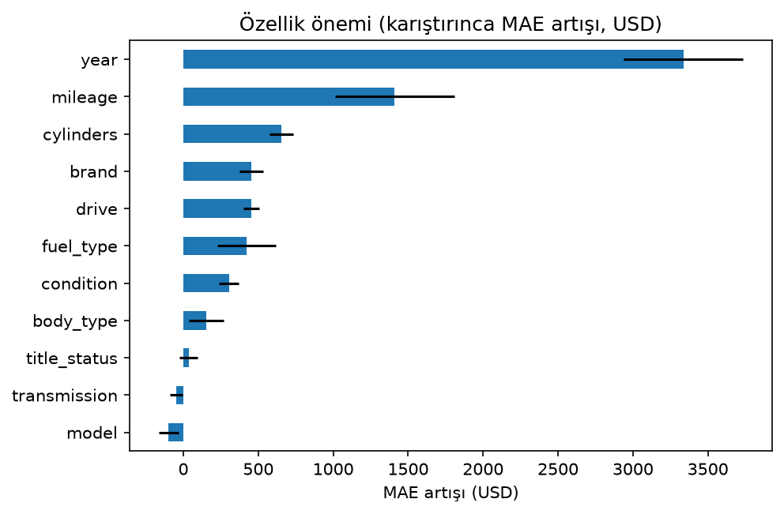

# Model Deney Günlüğü

> Sorumlu: Kaan · Durum: **Dolduruldu** (16 Kasım 2026)

## 1. Değerlendirme düzeni

- Doğrulama: `train.csv` verisinin %20'si ayrılır (`random_state=42`). Model bu kısmı eğitimde hiç görmez.
- Çapraz doğrulama: 5 katlı `KFold` (Adım 8'den itibaren)
- Ana metrik: **MAE** (ortalama mutlak hata, para birimi cinsinden; anlaması en kolay olan)
- Ek metrikler: RMSE, R²
- Veri az (771 satır) olduğu için model seçimi **5 katlı CV MAE** ile yapılır; holdout (%20 = 155 satır) ek bilgidir ve tek bölme gürültülüdür.
- Yarışma metriği: `____` (DATA.md §1)

## 2. Deneyler

Her denemeyi bir satır olarak ekle, kötü sonuç verenleri de. Neyin işe yaramadığı da bir bulgudur.

| # | Tarih | Model | Özellikler / değişiklik | Önemli parametreler | MAE | RMSE | R² | Not |
|---|---|---|---|---|---|---|---|---|
| 0 | 16 Kas 2026 | Baseline (medyan) | – | – | 9094 / CV 10084 | 15966 / CV 17857 | -0,123 / CV -0,120 | Geçilmesi gereken çizgi |
| 1 | 16 Kas 2026 | Ridge + one-hot, log hedef | Ölçekli sayısal | `alpha=1.0` | 7442 / CV 7305 | 13948 / CV 14056 | 0,143 / CV 0,304 | Doğrusal ilişki yetersiz |
| 2 | 16 Kas 2026 | RandomForest | One-hot, log hedef | `n_estimators=300` | 5854 / CV 6048 | 12400 / CV 12516 | 0,323 / CV 0,448 | Holdout'ta en iyi varsayılan |
| 3 | 16 Kas 2026 | HistGradientBoosting | One-hot, log hedef | varsayılan | 5966 / CV 6028 | 12576 / CV 12182 | 0,303 / CV 0,475 | CV'de en iyi varsayılan |
| 4 | 16 Kas 2026 | HistGradientBoosting (ayarlı) | RandomizedSearchCV, 15 deneme | bkz. §3 | 5445 / CV 5881 | 11855 / CV 12123 | 0,381 / CV 0,481 | Seçilen model |

Her hücre "holdout / CV ortalaması" biçimindedir. MAE ve RMSE USD cinsindendir. CV MAE standart sapmaları: Ridge 551, RF 589, HistGB 792, ayarlı HistGB 808.

## 3. Seçilen model

- Model: `HistGradientBoostingRegressor` (log1p hedef, one-hot ön işleme)
- Parametreler: `learning_rate=0.03, max_iter=400, max_leaf_nodes=15, min_samples_leaf=5, l2_regularization=0`
- 5 katlı CV sonuçları: MAE `5881` (± 808) · RMSE `12123` · R² `0,481` (holdout MAE 5445)
- Baseline'a göre iyileşme: MAE'de `%41,7` (10084 -> 5881, CV)
- Neden bu model: CV MAE'si en düşük ağaç modeli HistGB oldu ve ayarlama varsayılana göre CV MAE'yi 6028'den 5881'e indirdi (küçük bir kazanç; fark standart sapma içinde, o yüzden iddialı yorumlanmamalı). Ridge, ağaç modellerinden belirgin kötüydü.
- `train.py` çıktısı (tüm veriyle eğitilen model, out-of-fold tahminlerle): MAE 5881 · RMSE 12302 · R² 0,477.
- Bu metrikler USD içindir; Türkiye fiyatları için ayrı bir yerel katsayı uygulanacaktır.

## 4. Özellik önemleri

- Holdout üzerinde permutation importance (MAE artışı): `year` (yaklaşık 3337 USD) açık ara en önemli özellik.
- Ardından `mileage` (1411), `cylinders` (654), `brand` (452), `drive` (451) ve `fuel_type` (423) gelir.
- `model`, `transmission` ve `title_status` neredeyse sıfır veya hafif negatif önem gösterdi; küçük holdout'ta gürültü sayılır. `model` sütunu çok sayıda seyrek sınıf içerdiğinden fazla bilgi taşımıyor.
- Önem değerleri 155 satırlık holdout ve 5 tekrara dayanır, sıralama küçük farklarda değişebilir.

## 5. Hata analizi

- Marka bazında (en az 5 holdout ilanı) ortalama mutlak hata en yüksek: Mercedes-Benz 7604 USD (7 ilan), Chevrolet 6721 (14), Ford 5602 (24), Toyota 4733 (23); en düşük Hyundai 1828 (9).
- Fiyat dilimine göre medyan oransal hata U biçimli: en ucuz dilimde (1200-5000 USD) %31,6, orta dilimlerde %15-27, en pahalı dilimde (23180 USD üzeri) %31,2.
- Ucuz arabalarda küçük mutlak hata bile büyük oransal hata demektir; pahalı arabalarda ise az örnek olduğu için model zayıf.
- Holdout küçük olduğundan marka tabloları yalnızca yön gösterir; ilan sayısı az markalarda ortalamalar oynaktır.

## 6. Kaggle sonucu (bonus)

| Tarih | Model sürümü | Public skor | Not |
|---|---|---|---|
| | | | |

## 7. Türkiye uyarlaması

**Yöntem:** Model ABD verisiyle USD tahmin eder. Servis `fiyat_TL = fiyat_USD x TCMB USD/TRY kuru x katsayı` hesaplar. Katsayı eğitimden sonra, Türkiye ilan fiyatlarına bakılarak bulunur (`src/ml/localization.py`); model değişmediği için metrikler (MAE, RMSE, R²) USD olarak kalır. Kur TCMB'nin günlük dosyasından günde bir kez çekilir, internet yoksa yedek kur (50,39) kullanılır.

Referans: sahibinden/arabam.com, 16 Kasım 2026, kur 50,3942 (TCMB). Hepsi benzinli otomatik (Tesla elektrikli), temiz ruhsat. Oran = TL fiyat / (USD tahmin x kur).

| Araç | Segment | Fiyat (TL) | Model tahmini (USD) | Oran |
|---|---|---|---|---|
| Honda Civic 2017, 200.000 km | ekonomik | 1.250.000 | 9993 | 2,482 |
| Toyota Corolla 2011, 235.000 km | ekonomik | 800.000 | 5870 | 2,705 |
| Honda Accord 2013, 175.000 km | ekonomik | 900.000 | 7936 | 2,250 |
| Toyota RAV4 2015, 165.000 km | suv | 1.250.000 | 12514 | 1,982 |
| Jeep Wrangler 2019, 70.000 km | suv | 4.200.000 | 30762 | 2,709 |
| BMW X5 2020, 150.000 km | premium | 3.750.000 | 24484 | 3,039 |
| Porsche Cayenne 2014, 190.000 km | premium | 4.150.000 | 10973 | 7,505 |
| Tesla Model 3 2021, 130.000 km | elektrik | 2.200.000 | 20757 | 2,103 |

**Segment katsayıları** (oranların geometrik ortalaması): ekonomik 2,472 · suv 2,317 · premium 4,776 · elektrik 2,103 · genel 2,810. Referansı olan marka+model kendi oranını kullanır; yoksa segment, o da yoksa genel katsayı uygulanır.

**Sınırlamalar:**
- Katsayılar yalnızca 8 ilana dayanır; iki premium örnek arasında büyük fark var (Porsche Cayenne oranı X5'in iki katından fazla), bu yüzden premium katsayısı güvenilmezdir.
- Türkiye'ye özgü ilan fiyatları (vergi, ithalat maliyeti) tek bir çarpana sıkıştırılır; yaş ve km etkisi segmentler arasında aynı varsayılır.
- ABD verisinde olmayan Renault, Peugeot, Togg gibi markalar tahmin edilemez.
- Kur ve piyasa fiyatları zamanla değişir; katsayılar yeniden eğitimle güncellenmelidir.
